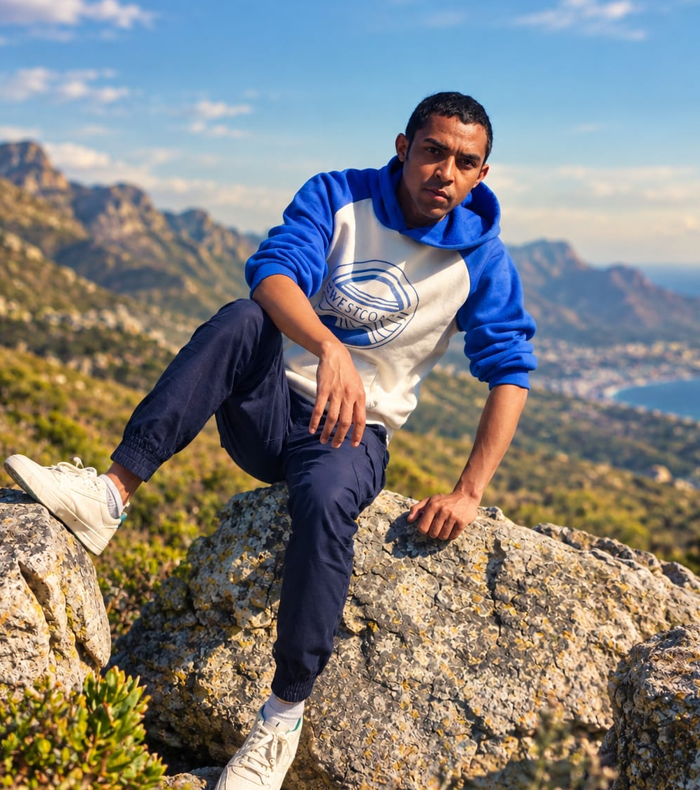

---
hide:
  - toc
  - navigation
---

  
  <h1>Fiononana Rasamimanana</h1>
  
<strong>Machine Learning Engineer · Geomatics Expert · Remote Sensing & Spatial Analysis</strong>

  
<em>Turning spatial data into insights | GIS | Remote Sensing | Deep Learning | Python</em>

---

## About Me

I am a geomatics and remote sensing specialist with advanced Master-level training, based in Cape Town, South Africa. I use geospatial data and deep learning to address environmental and territorial challenges, from vegetation mapping to environmental health assessment.

My background spans the University of Antananarivo (Master 2 in Earth Physics, thesis defended in August 2026), the University of La Réunion (international credit mobility in Geomatics and Remote Sensing), and research internships at INERIS in France and the Institute and Observatory of Geophysics of Antananarivo (IOGA) in Madagascar. I am currently pursuing an MSc in Applied Mathematics at Stellenbosch University to strengthen my quantitative and analytical skills.

My recent work has focused on two main areas:

- **Remote sensing and deep learning:** automatic detection of individual vegetable, allotment and ornamental gardens from 20 cm aerial imagery (IGN BD ORTHO). A U-Net with a ResNet-34 encoder reached 83 % overall accuracy versus 58 % for Random Forest, and an IoU of 82 % on allotment gardens in the Oise test area.
- **GIS and environmental data:** structuring a PostgreSQL / PostGIS road network database and automating the collection and harmonization of open road traffic data (94 of 101 departments inventoried, 291,460 road segments) for environmental health risk assessment.

Earlier, at IOGA, I produced Sentinel-2 land cover maps of Ankarafantsika National Park (2018 and 2023, with overall accuracies of 91.4 % and 93.0 %) and built an ecosystem accounting approach in SAGA GIS.

I am particularly interested in scientific and applied projects combining satellite Earth observation, spatial modeling and vegetation dynamics, especially forest disturbance and recovery monitoring, with a focus on international opportunities in Europe and South Africa.

  

---

[View My Projects :material-arrow-right:](projects/index.md){ .md-button .md-button--primary }
[Download CV :material-download:](assets/CV_Fiononana.pdf){ .md-button }

---

## Skills

-   :material-layers:{ .lg .middle } **GIS & Remote Sensing**

    ---

    - QGIS, SNAP, SAGA GIS, OTB toolbox, Google Earth Engine
    - Sentinel-1 and Sentinel-2 processing
    - Very-high-resolution aerial imagery (IGN BD ORTHO, 20 cm)
    - Terrain data: IGN LiDAR height model, SRTM
    - Supervised and unsupervised classification, thematic mapping

-   :material-code-braces:{ .lg .middle } **Programming**

    ---

    - Python — rasterio, NumPy, scikit-learn, Albumentations, Folium
    - SQL, Git
    - JavaScript (Google Earth Engine)
    - MATLAB, SageMath, R (beginner)

-   :material-star-four-points:{ .lg .middle } **Machine Learning & GeoAI**

    ---

    - Random Forest classification
    - Deep learning for image segmentation — U-Net (ResNet-34 encoder)
    - Training pipelines: tiling, normalization, data augmentation
    - Model training on Google Colab GPU

-   :material-database:{ .lg .middle } **Spatial Data & Web Mapping**

    ---

    - PostgreSQL + PostGIS
    - Automated collection and harmonization of open data
    - Web mapping with Python and Folium
    - Formats: GeoTIFF, GeoJSON

-   :material-leaf:{ .lg .middle } **Ecology & Fieldwork**

    ---

    - Land cover and ecosystem accounting (SAGA GIS)
    - Tropical ecosystems and plant ecology
    - Field campaigns and GPS reference data with KoboCollect

-   :material-sigma:{ .lg .middle } **Mathematics & Geophysics**

    ---

    - MSc Applied Mathematics (Stellenbosch University, in progress)
    - Statistical learning and numerical modelling
    - Geophysical prospecting (electrical, magnetic, seismic)

---

## Connect

[GitHub](https://github.com/fy0500){ .md-button }
[LinkedIn](https://linkedin.com/in/fiononana-rasamimanana){ .md-button }