# Ecosystem Natural Capital Accounting of Land Cover, Ecosystem Infrastructure and Water Resources in Ankarafantsika National Park (2018–2023)

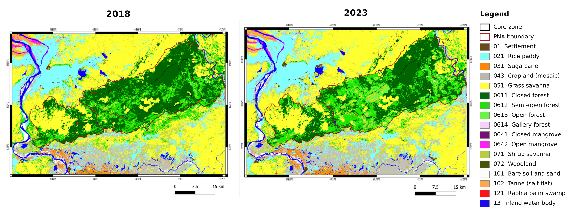
*Land cover of Ankarafantsika National Park (PNA) and its surroundings in 2018 and 2023, mapped from Sentinel-2 imagery with Random Forest (17 classes).*

## Overview

I applied the Ecosystem Natural Capital Accounting (CECN) quick-start package of the Convention on Biological Diversity (Weber, 2014) to Ankarafantsika National Park and its surroundings, and built three biophysical accounts for 2018 and 2023: a land cover account, an ecosystem infrastructure account (the capacity of ecosystems to keep providing intangible services) and a water resource account. Land cover is mapped from Sentinel-2 imagery with Random Forest, and every other account is built on top of those maps. The goal is to give park managers a measurable summary of the state and evolution of the park's natural capital.

**Study Area:** Ankarafantsika National Park (136,513 ha, IUCN category II) and its surroundings, Boeny region, north-west Madagascar (493,045 ha mapped)  
**Duration:** August 2024 – June 2025 (Master's thesis, Physics and Applications, Earth Physics track)  
**Role:** Solo project (hosted by the Laboratory of Environmental Geophysics and Remote Sensing, IOGA, University of Antananarivo; supervised by two professors)  
**Partners:** Madagascar National Parks, Critical Ecosystem Partnership Fund (as shown on the report cover)  
**Status:** Completed
---
## Methods & Tools

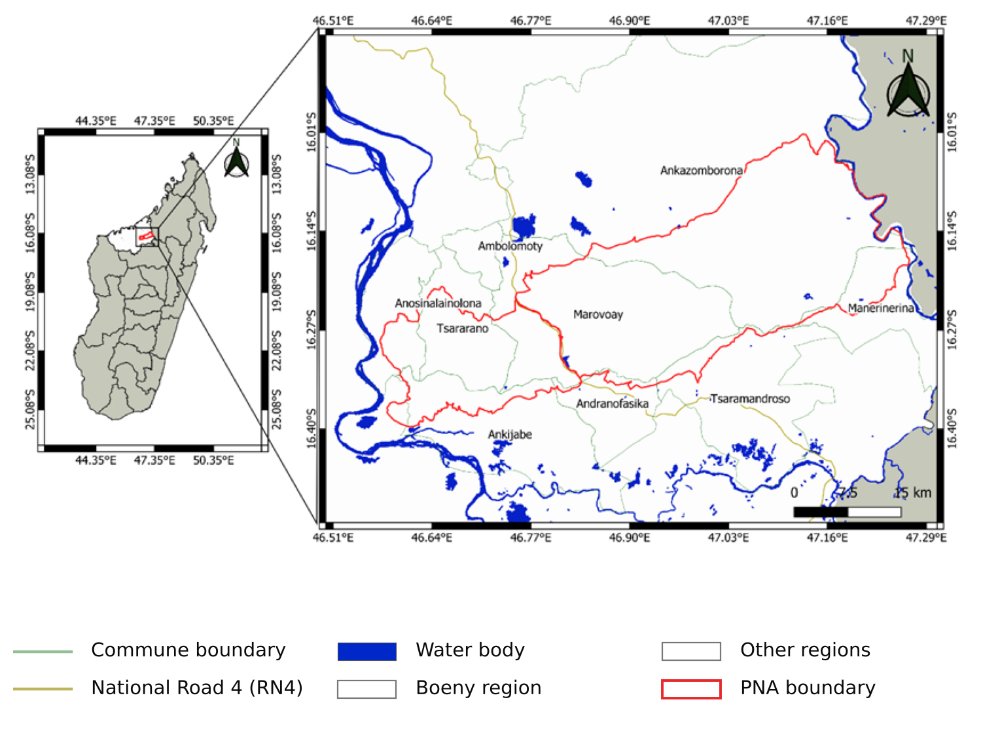
*Study area: Ankarafantsika National Park and the nine communes it straddles, in the Boeny region.*

**Data Sources**

- Sentinel-2 Level-1C imagery, 2018 and 2023, dry and wet seasons, cloud cover below 20 % (processed in Google Earth Engine)
- Field GPS points collected in August 2024 to build training parcels
- Field surveys: 35 people interviewed in four fokontany along National Road 4, a socio-economic survey of 75 people, and five ecological plots
- SRTM digital elevation model (30 m) for the watersheds; HydroSHEDS, HydroRIVERS, GloRiC, HydroLAKES and WHYMAP for rivers, lakes and groundwater
- CHIRPS annual rainfall, WorldClim 30-year normals and WaPOR v3 evapotranspiration (300 m)
- INSTAT household data (2018), building counts from high-resolution imagery as a household proxy for 2023, OpenStreetMap roads, Global Dam Watch dams, and park tourism statistics

*Field GPS points used to delineate training parcels (August 2024).*

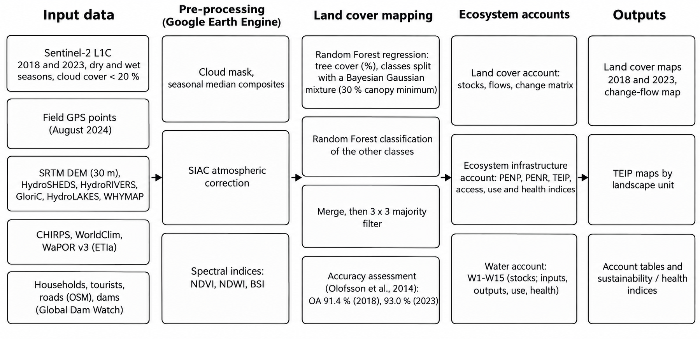
*Methodological workflow, from Sentinel-2 images and ancillary data to the three accounts.*

### Part 1: Land cover account

1. Corrected Sentinel-2 Level-1C images for atmosphere with SIAC in Google Earth Engine, masked clouds and computed NDVI, NDWI and BSI.
2. Estimated the percentage of tree cover for each pixel with Random Forest regression, then split it into forest classes (closed, semi-open, open) with a Bayesian Gaussian mixture, using a 30 % canopy minimum as the forest definition.
3. Classified the other land cover classes with Random Forest, merged both outputs and cleaned the result with a 3 × 3 majority filter (17 classes in total).
4. Validated each map with stratified random points interpreted on very-high-resolution imagery, using the area-based estimators of Olofsson et al. (2014).
5. Built the change matrix between 2018 and 2023, removed impossible transitions (for example open water to forest) and classified every change into one of seven flow types (lf1 to lf7) to obtain opening stocks, gains, losses and closing stocks.

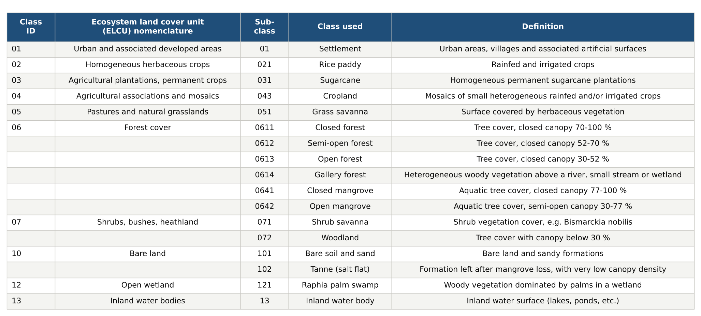
*Land cover nomenclature, following the CECN ecosystem land cover units.*

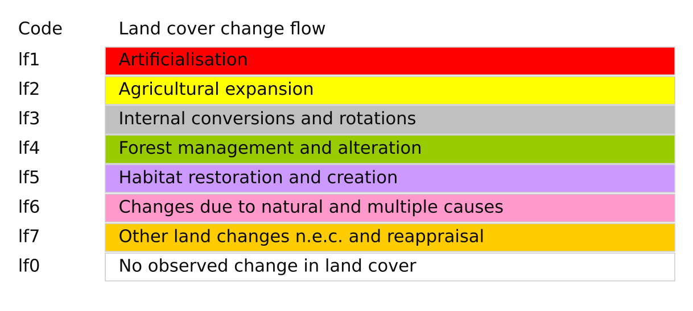
*Land cover change flows used to build the account.*

### Part 2: Ecosystem infrastructure account

6. Built the Landscape Ecosystem Potential for each watershed as the product of three indices: the Green Landscape Background Index (biomass potential × biotic regulation capacity, smoothed with a Gaussian filter in SAGA GIS), the High Natural Value Index (park zoning) and the landscape fragmentation index (effective mesh size).
7. Built the River Ecosystem Potential from a river accessibility index (length × ln of discharge, adjusted for annual rainfall), a river natural value index and a river fragmentation index (based on the number of dams, 1 / ln(x + e)).
8. Added both to obtain the Total Ecosystem Infrastructure Potential (TEIP), then computed access to services, a sustainable-use index (TEIP at the end of the period divided by TEIP at the start) and a health index (biodiversity integrity and fire impact).

### Part 3: Water account

9. Converted rainfall and evapotranspiration to volumes per watershed (1 mm = 10 m³/ha), estimated lakes and reservoirs from surface × depth, rivers in river-standard units (length × discharge), and soil and vegetation water as half of actual evapotranspiration.
10. Computed total inputs (W2), total outputs (W3), the net ecosystem water balance (W4 = W2 − W3), accessible water resources (W6 to W8), total water use (W9, W12) and the use-intensity (W7 / W9), sustainable-use and health indices.

**Tools Used**

| Tool | Purpose |
|------|---------|
| Google Earth Engine | Sentinel-2 processing, SIAC atmospheric correction, spectral indices, building counts |
| Random Forest | Tree-cover regression and land cover classification |
| QGIS | Mapping, watershed and river layers, overlays, SRTM download plugin |
| SAGA GIS | Gaussian smoothing of the landscape indices |
| Google Earth (very-high-resolution imagery) | Visual interpretation of validation points |

---

## Key Findings

### Land cover account

- Both maps are reliable: overall accuracy is 91.4 % in 2018 and 93.0 % in 2023, with a Kappa index of 0.9 for both dates.
- 18 % of the territory changed land cover between 2018 and 2023 (91,157 ha out of 493,045 ha); the remaining 82 % stayed stable.
- Settlements grew by 421 ha (+39 %), rice paddies by 8 %, cropland by 27 % and sugarcane by 7 %, driven by population growth and internal migration.
- Closed forest fell by 26 % (−22,404 ha) and semi-open forest by 11 %, mainly through conversion to savanna, bush fires, charcoal making and timber use; overall forest loss is about 11 % in five years (2.2 % per year).
- Woodland increased by 1,570 ha thanks to village and community reforestation, while raphia palm swamp (−56 ha), gallery forest (−86 ha) and inland water (−13 %) all shrank.

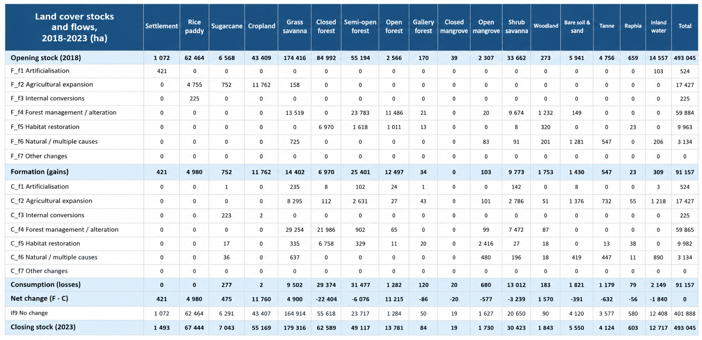
*Land cover account: opening stocks, formation (gains), consumption (losses) and closing stocks, in hectares.*

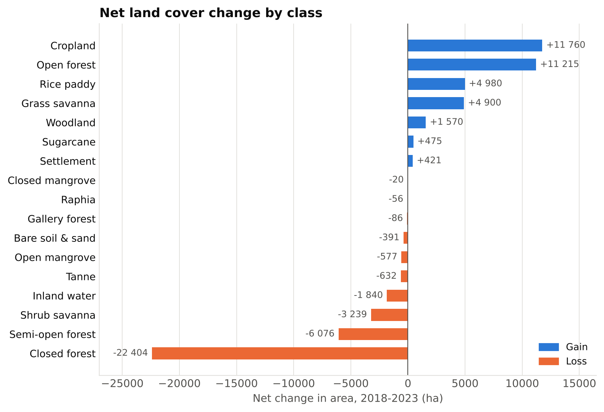
*Net change by class, 2018–2023. Closed forest lost 22,404 ha, while cropland gained 11,760 ha.*

### Ecosystem infrastructure account

- Potential grew where land is artificialised or farmed (urban +20 %, agriculture +61 %), but fell for forest (−11 %), wetland vegetation (−14 %), savanna (−10 %) and wetlands (−10 %), so the total TEIP across all units is about 6–7 % lower in 2023 than in 2018 (roughly 1 % per year).
- The park's core zone lost 2.75 % of its landscape potential over five years (0.55 % per year) and the protection zone about 6 %, mainly because forest is turning into savanna after fires.
- River potential barely changed overall, but the large Amboromalandy dam and the small rice-irrigation dams fragment rivers around Marovoay.
- The composite ecosystem health index is below 1 (0.88 in 2023), which indicates a degradation of ecosystem health.

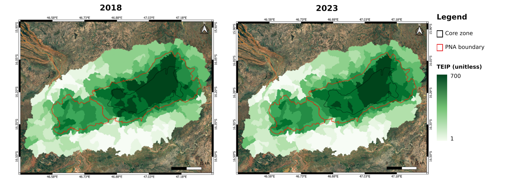
*TEIP by watershed in 2018 and 2023: the highest values follow the core zone of the park.*

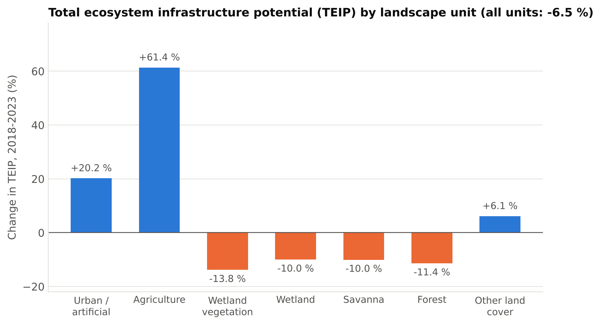
*Change in TEIP by landscape unit, computed from the values of the infrastructure account.*

*Landscape fragmentation index by watershed: the south of the study area, outside the park, is the most fragmented.*

### Water account

- Mean annual rainfall dropped from 1,980 mm to 1,674 mm (−15 %) and actual evapotranspiration from 1,533 mm to 1,132 mm (−26 %).
- The net ecosystem water balance fell by 22 % (about −4.4 % per year), the total renewable water resource by 20 % and the stock of lakes and reservoirs by 8 %, while secondary (irrigation) water rose by 23 %.
- Total water needs rose from 4.24 to 5.84 billion m³ (+38 %), driven by irrigation (about 25,500 m³ per hectare) and domestic use (about 90 L per household per day), but they stay well below the accessible surplus.
- The water-use intensity index stays at 1.00, the global sustainable-use index at 0.95 and the water health index at 0.85, so water use shows no depletion risk and water health is stable, although the margin is shrinking.

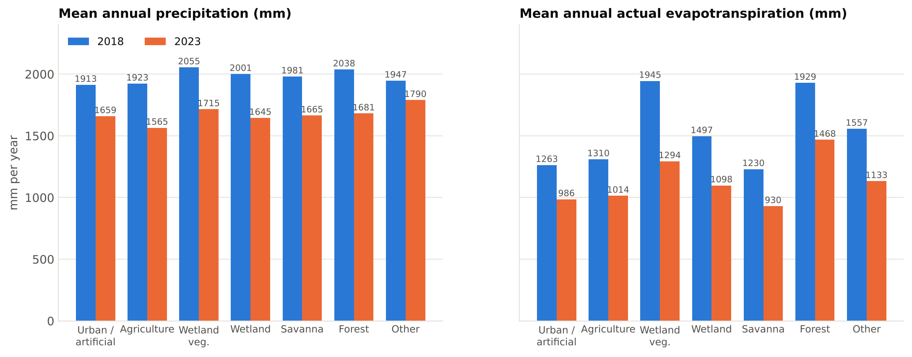
*Mean annual precipitation and actual evapotranspiration by landscape unit, 2018 vs 2023.*

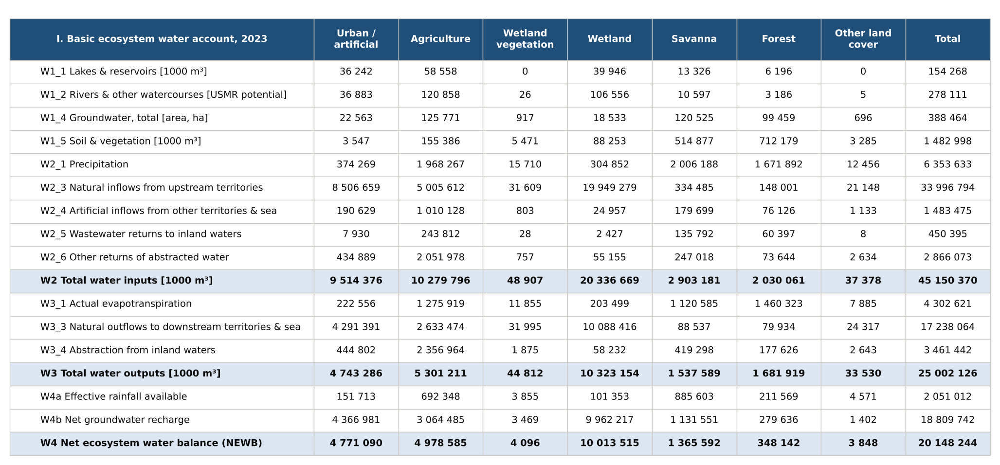
*Basic ecosystem water account for 2023 (1,000 m³ unless stated otherwise).*

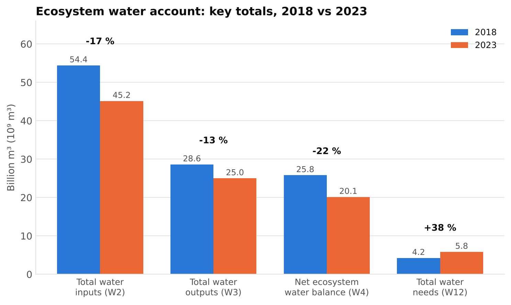
*Key water account totals: inputs and net balance fall while water needs rise.*

### Limitations and next steps

- Most hydrological inputs are global datasets that I resampled to 1 km; household numbers for 2023 are a proxy based on visible buildings, which can miss houses hidden under dense vegetation.
- Land cover is mapped at 10 m, so classification quality drives the reliability of every other account.
- Next steps are to add the carbon account and the total ecosystem capability account, to value the accounts in monetary terms, and to extend them to the whole Boeny region.

---

## Links

[View Methodology (Weber, 2014)](https://www.wavespartnership.org/en/node/374){ .md-button }
[View Rainfall Data (CHIRPS)](https://www.chc.ucsb.edu/data/chirps){ .md-button }
[View Hydrography Data (HydroSHEDS)](https://www.hydrosheds.org){ .md-button }
