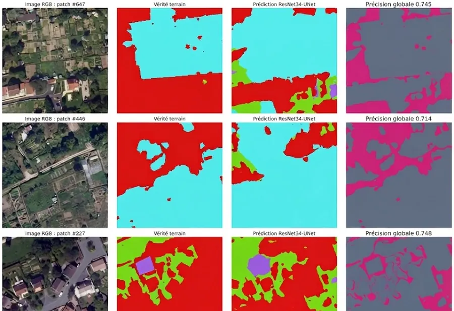
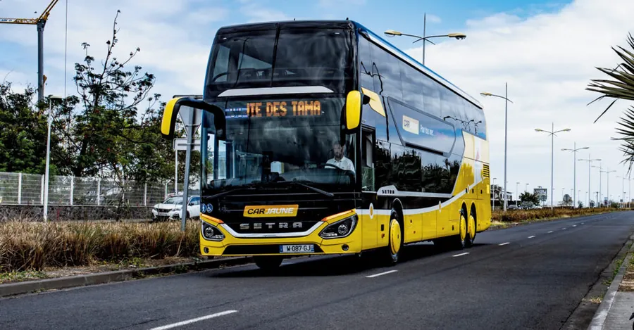
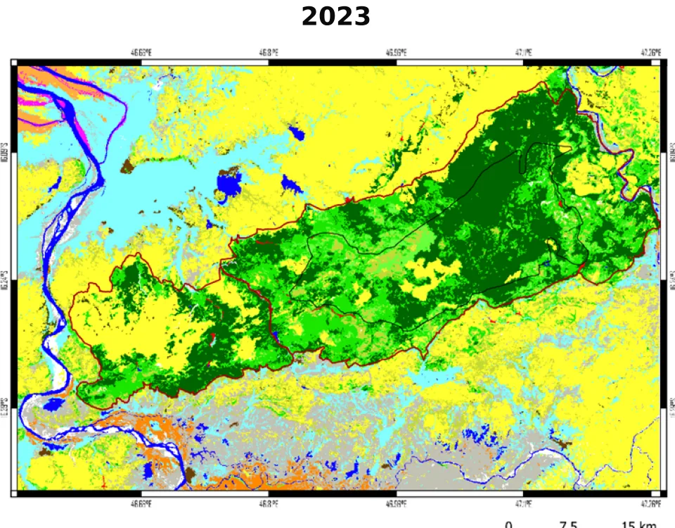

---
hide:
  - toc
  - navigation
---

# Projects

A selection of my geospatial work, from satellite land cover to deep learning on aerial imagery and live transport data. Click any card to open the full write-up.

<article class="proj proj--feature">

01

Feb – Jul 202649.05° N · 2.45° EINERIS, France

<h2><a href="sample-project/">Automated Detection of Private Vegetable Gardens with Remote Sensing and Deep Learning</a></h2>

Deep learning model to detect gardens from aerial imagery and a road traffic database for environmental health assessment.

<ul class="tags"><li>Python</li><li>PyTorch</li><li>PostgreSQL / PostGIS</li><li>QGIS</li><li>Google Colab</li></ul>
Read the case study →

</article>

<article class="proj">

02

Notebook21.12° S · 55.54° ELa Réunion

<h2><a href="PostGIS_en/">Real-Time Car Jaune Bus Tracking with PostGIS</a></h2>

Retrieved live bus positions from the Car Jaune GTFS-RT feed, matched each vehicle to its nearest stop using the static GTFS, mapped everything with Folium, and stored the latest positions in a PostGIS table.

<ul class="tags"><li>Python</li><li>GeoPandas</li><li>Folium</li><li>PostGIS</li><li>GTFS</li></ul>
Open the notebook →

</article>

<article class="proj">

03

2024 – 202516.32° S · 46.80° EMadagascar

<h2><a href="ecosystem-accounting-ankarafantsika/">Ecosystem Natural Capital Accounting in Ankarafantsika National Park (2018–2023)</a></h2>

Mapped land cover from Sentinel-2 with Random Forest (17 classes, 91–93 % overall accuracy), then built land cover, ecosystem infrastructure and water accounts for Ankarafantsika National Park and its surroundings, showing an 18 % land cover change, a 26 % loss of closed forest and a 22 % drop in the net ecosystem water balance.

<ul class="tags"><li>Remote Sensing</li><li>Sentinel-2</li><li>Random Forest</li><li>Google Earth Engine</li><li>QGIS</li><li>Ecosystem Accounting</li></ul>
Read the case study →

</article>

