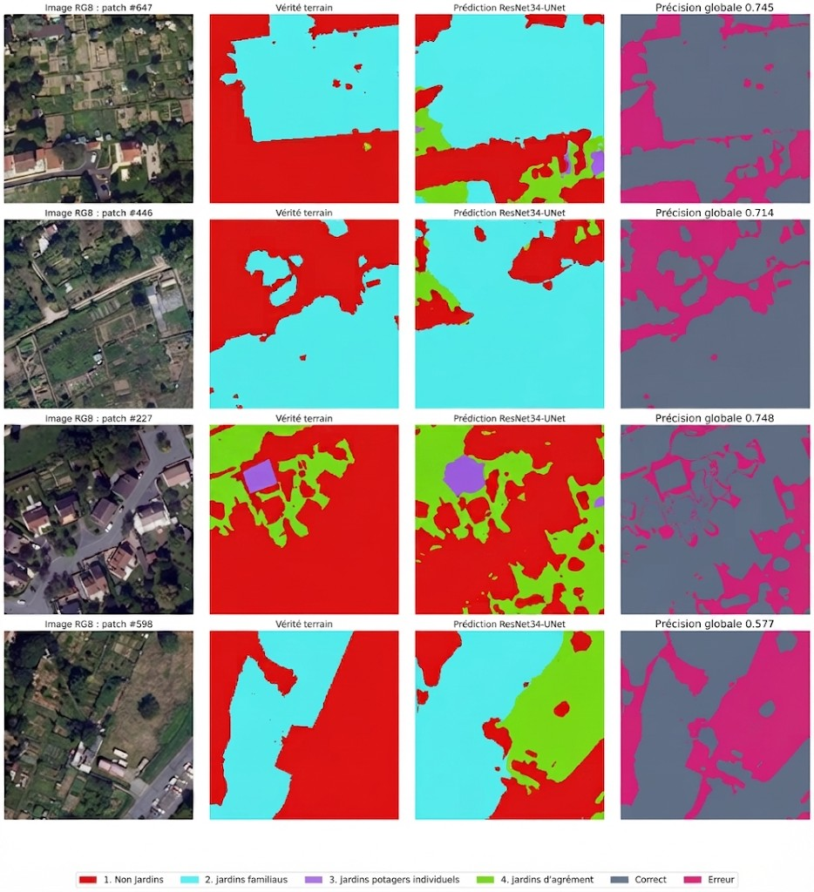

---
hide:
  - toc
  - navigation
---

# Projects

A selection of my geospatial projects. Click any card to see the full write-up.

**[Sample Project](sample-project.md)**

Deep learning model to detect gardens from aerial imagery and a road traffic database for environmental health assessment.

`Python` `PyTorch` `PostgreSQL / PostGIS` `QGIS` `Google Colab`

[View Project →](sample-project.md){ .md-button }

**[Real-Time Car Jaune Bus Tracking with PostGIS](PostGIS_en.ipynb)**

Retrieved live bus positions from the Car Jaune GTFS-RT feed, matched each vehicle to its nearest stop using the static GTFS, mapped everything with Folium, and stored the latest positions in a PostGIS table.

`Python` `GeoPandas` `Folium` `PostGIS` `GTFS`

[View Project →](PostGIS_en.ipynb){ .md-button }

**[Ecosystem Natural Capital Accounting in Ankarafantsika National Park (2018–2023)](ecosystem-accounting-ankarafantsika.md)**

Mapped land cover from Sentinel-2 with Random Forest (17 classes, 91–93 % overall accuracy), then built land cover, ecosystem infrastructure and water accounts for Ankarafantsika National Park and its surroundings, showing an 18 % land cover change, a 26 % loss of closed forest and a 22 % drop in the net ecosystem water balance.

`Remote Sensing` `Sentinel-2` `Random Forest` `Google Earth Engine` `QGIS` `Ecosystem Accounting`

[View Project →](ecosystem-accounting-ankarafantsika.md){ .md-button }

