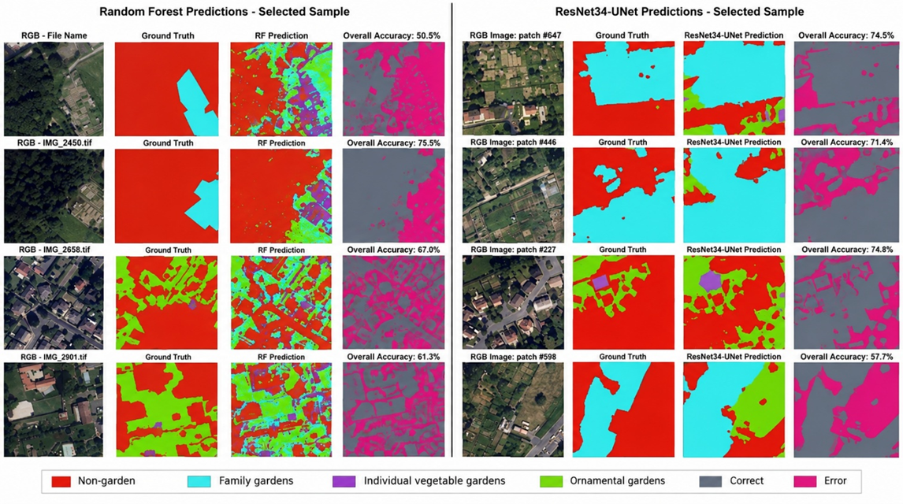
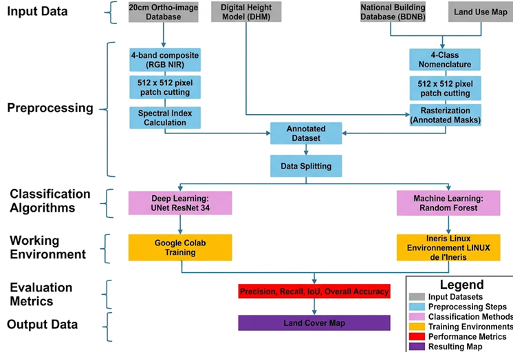
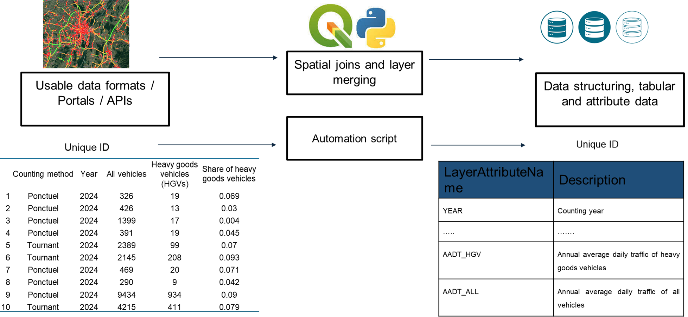
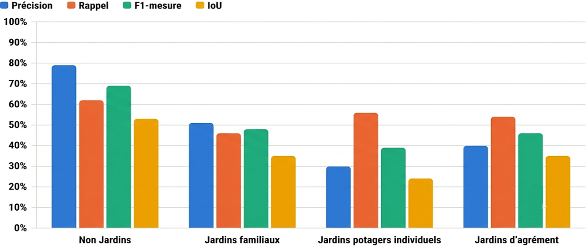
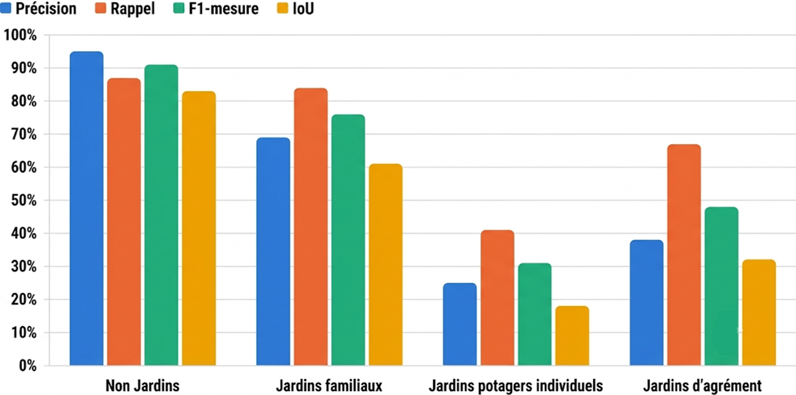
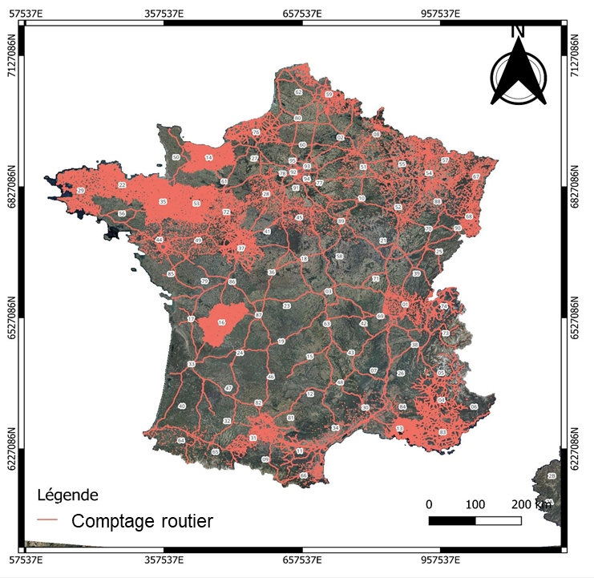

# Automated Detection of Private Vegetable Gardens Using Remote Sensing and Deep Learning, and Structuring of Road Traffic Activity Data

*Selected samples: RGB image, ground truth, model prediction and correct/error map for Random Forest (left) and ResNet34-UNet (right).*

## Overview

I built a U-Net (ResNet-34 encoder) pipeline that detects and classifies private gardens (allotment gardens, individual vegetable gardens and ornamental gardens) from 20 cm IGN orthophotographs and NDVI / MSAVI2 spectral indices, and I structured an open road-traffic database for France. Both parts support the assessment of how people are exposed to pollutants in soils and air (INERIS, French National Institute for Industrial Environment and Risks).

**Study Area:** Île-de-France (model training, about 12,000 km²) and a 25 × 25 km area of the Oise department (independent test); road-traffic inventory covering metropolitan France  
**Duration:** February 2026 – July 2026 (Master's thesis defended 13 August 2026)  
**Role:** Solo project (internship at INERIS, supervised by two engineers)  
**Status:** Completed
---
## Methods & Tools

**Data Sources**

- BD ORTHO® orthophotographs, IGN, 20 cm resolution (Île-de-France for training, Oise 2024 for testing)
- MOS (Mode d'Occupation des Sols) of Île-de-France, Institut Paris Région: land-use inventory used to build ground-truth garden masks
- Open road-traffic data (annual average daily traffic, TMJA) published by French departments

### Part 1: Garden detection

1. Rasterised the MOS garden classes into 20 cm masks aligned with the orthophoto tiles (four classes: non-garden, allotment, individual vegetable and ornamental gardens).
2. Computed NDVI and MSAVI2, stacked them with the image bands, and cut the data into 512 × 512 px tiles (3,330 tiles, split 70 / 10 / 20 % for training, validation and test).
3. Normalised and augmented the tiles (Albumentations), then trained a U-Net with an ImageNet-pretrained ResNet-34 encoder (balanced focal loss, early stopping) and a Random Forest baseline.
4. Evaluated both models with confusion matrices, overall accuracy, Cohen's Kappa and per-class precision, recall, F1 and IoU, then applied the U-Net to an independent area of the Oise.

*Methodological workflow, from the 20 cm orthoimages, DHM, BDNB and land-use map to the final land cover map.*

### Part 2: Road-traffic database

5. Wrote Python scripts that query departmental open-data portals and APIs, harmonised the traffic data and loaded it into a PostgreSQL / PostGIS database.

*Traffic-data pipeline: from heterogeneous open-data formats to a structured, attribute-documented database keyed by a unique ID.*

**Tools Used**

| Tool | Purpose |
|------|---------|
| Python (rasterio, NumPy, scikit-learn, Albumentations) | Raster preprocessing, spectral indices, data augmentation, Random Forest baseline |
| U-Net with ResNet-34 encoder | Semantic segmentation of gardens |
| Google Colab (GPU) | Model training and inference |
| QGIS | Spatial joins and layer merging |
| PostgreSQL / PostGIS | Storage and structuring of the road-traffic database |

---

## Key Findings

### Garden detection

- The U-Net reached 83 % overall accuracy (Kappa 0.57) on the Île-de-France test set, against 58 % (Kappa 0.37) for Random Forest.
- On an independent area of the Oise, the U-Net reached 78 % overall accuracy (Kappa 0.56): allotment gardens were detected best (IoU 82 %, recall 92 %) and individual vegetable gardens reached an IoU of 56 % (recall 81 %, precision 64 %).
- Individual vegetable gardens remain the hardest class because of their spectral variability and their confusion with other vegetated surfaces; ornamental gardens show many false positives (precision 55 %).

**Random Forest baseline: per-class metrics**

**U-Net (ResNet-34): per-class metrics**

*The U-Net clearly outperforms the Random Forest on non-garden and allotment gardens, while individual vegetable and ornamental gardens remain difficult for both models.*

### Road-traffic inventory

- The inventory covers 94 of the 101 French departments (93.1 %) and 291,460 road segments, with automated collection for 7 departments.

*Coverage of the road-traffic counting inventory across metropolitan France (department numbers shown).*

---

## Links

[View Code on GitHub](https://github.com/fy0500/My-work){ .md-button }
[View Data Source](https://geoservices.ign.fr/bdortho){ .md-button }