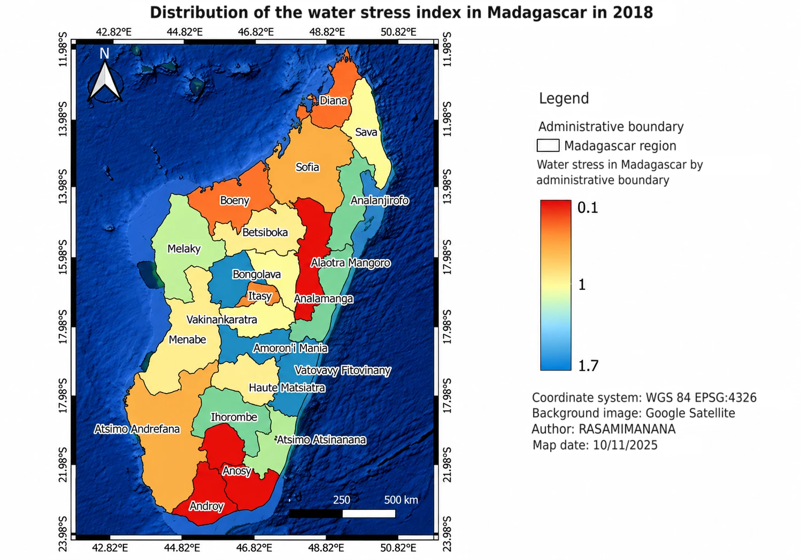
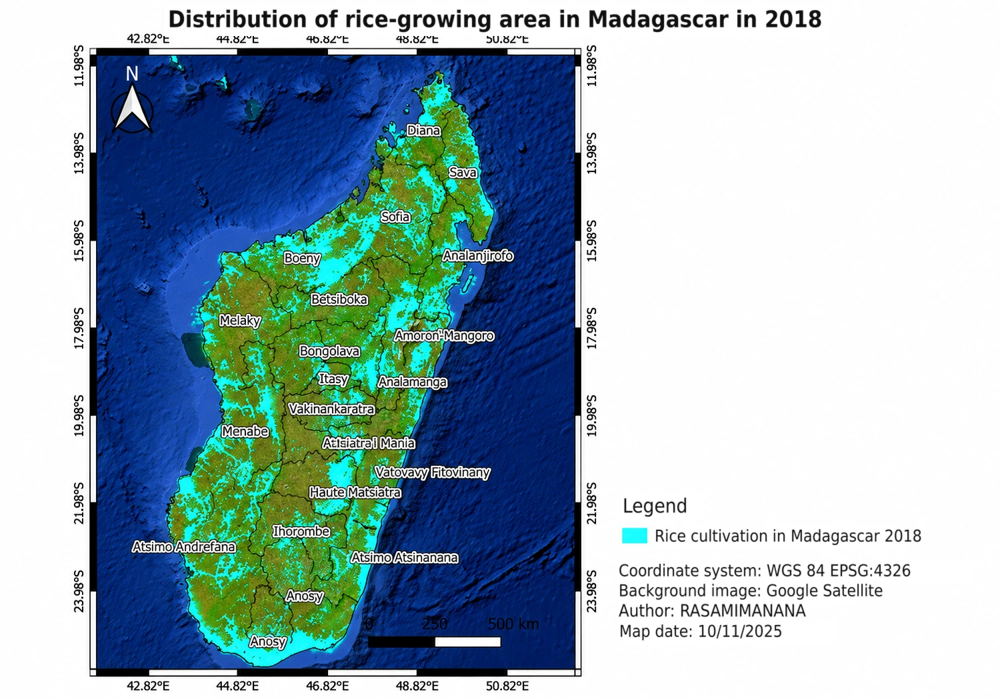
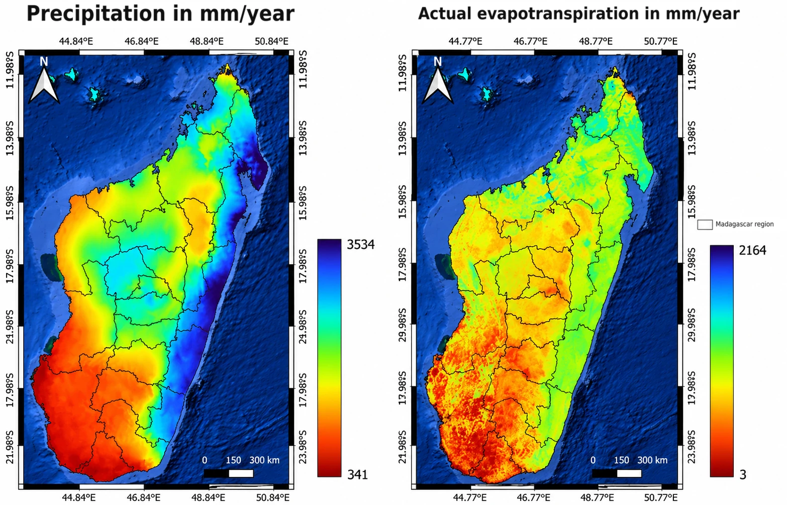
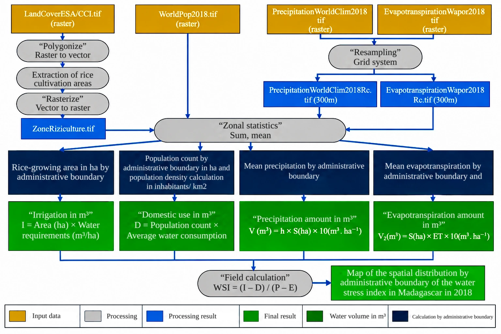
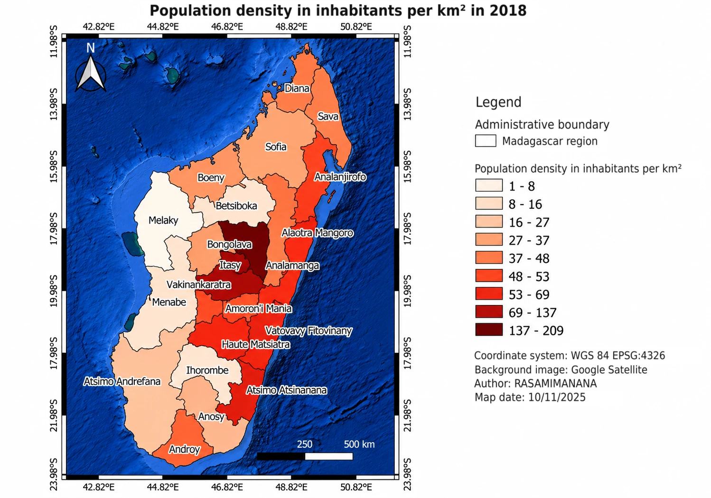

# Spatial Analysis of Water Stress in Madagascar Using GIS

*Water stress index by administrative region in Madagascar, 2018. Red regions are those where estimated water demand exceeds the renewable resource.*

## Overview

Water stress occurs when the demand for water exceeds the resource available. In Madagascar, agriculture alone accounts for about 92 % of water withdrawals (excluding hydropower) and 29 % of GDP (2012), and rice is its dominant crop. I built a regional water stress index for 2018 entirely in QGIS, by comparing the net renewable water of each administrative region (precipitation minus actual evapotranspiration) with its total demand (rice irrigation plus domestic use). I then read the result against population density and the distribution of rice-growing areas, the two factors that drive demand. The goal is to identify and characterise the regions most exposed to water shortage, to support planning for sustainable and equitable water management.

**Study Area:** Madagascar, at the scale of its administrative regions  
**Reference Year:** 2018  
**Duration:** Autumn 2025 (final maps dated 10 November 2025)  
**Role:** Solo project (GIS course project, Master RNET, University of La Réunion)  
**Status:** Completed

---

## Methods & Tools

**Data Sources**

- Land cover: ESA CCI land cover maps for 2018 (about 300 m resolution, 22 LCCS classes), distributed by the Copernicus Climate Change Service, used to extract rice-growing areas
- Precipitation: WorldClim (Fick & Hijmans, 2017)
- Actual evapotranspiration and interception: WaPOR v3, annual, 300 m (FAO, 2023)
- Population: WorldPop gridded population counts (Bondarenko et al., 2025)
- Administrative boundaries: regions of Madagascar from the BNGRC (national disaster risk management office)

*Rice-growing areas in 2018, extracted from the ESA CCI land cover map.*

*Mean annual precipitation (WorldClim) and actual evapotranspiration (WaPOR v3), 2018.*

### Workflow

1. **Rice mask.** Polygonised the ESA CCI land cover raster, extracted the rice cultivation class and rasterised it again into a rice-area layer.
2. **Common grid.** Resampled the precipitation and evapotranspiration rasters to a 300 m grid with the SAGA resampling tool (nearest neighbour), so that every cell lines up for the later calculations.
3. **Zonal statistics.** Aggregated the rasters inside each administrative region: sum for rice area and population, mean for precipitation and evapotranspiration. Population density in inhabitants per km² was derived from the population count.
4. **Water volumes.** Converted everything to cubic metres in the attribute table with the field calculator (see below).
5. **Index and mapping.** Computed the water stress index per region and designed the thematic maps in the QGIS layout manager.

*Workflow of the analysis, from the input rasters to the water stress index map.*

**Water volumes**

| Component | Calculation |
|-----------|-------------|
| Irrigation demand (I) | Rice area (ha) × 12,000 m³/ha, the FAO-based water need for one full rice cycle, also used by Blanc-Pamard (1989) |
| Domestic demand (D) | Population count × 20 L per person per day (WHO, 2003; Howard et al., 2020) |
| Precipitation (P) | V₁ (m³) = mean precipitation (mm) × area (ha) × 10 m³/ha |
| Evapotranspiration (E) | V₂ (m³) = area (ha) × mean evapotranspiration (mm) × 10 m³/ha |

One millimetre of water over one hectare equals 10 m³, which is the conversion used for P and E.

**The index.** The water stress index adapts the Water Stress Index of Falkenmark (1989). It compares the net renewable resource (P − E) with the total demand (I + D) of each region. A value of 1 means the resource and the demand are in balance, a value below 1 means that demand exceeds the resource, and a value above 1 means a surplus.

**Tools Used**

| Tool | Purpose |
|------|---------|
| QGIS | Polygonize and rasterize, zonal statistics, field calculator, map layouts |
| SAGA GIS (resampling) | Harmonising raster resolution (nearest neighbour) |
| ESA CCI, WorldClim, WaPOR v3, WorldPop | Land cover, climate and population inputs |

---

## Key Findings

- The index ranges from 0.1 to 1.7 across regions, so water stress is very unevenly distributed. The four regions below stand out as hotspots.
- **Alaotra Mangoro** hosts the largest rice area of the country (about 188,200 ha, JICA 2025), so its irrigation demand is the highest and its index falls to the stressed end of the scale.
- **Androy and Anosy**, in the semi-arid south, combine a large rainfall deficit with frequent droughts and low groundwater recharge. Their renewable resource stays below demand, which makes supply insufficient for domestic, agricultural and environmental needs.
- **Boeny**, the second rice granary of Madagascar (about 134,275 ha, mainly the Marovoay plain), also shows a significant demand for irrigation water.
- **Amoron'i Mania, Bongolava, Vatovavy-Fitovinany and Ihorombe** have a water surplus linked to above-average rainfall. Ihorombe also has a very low population density, which keeps its demand low.
- The regions of the east coast have a more favourable balance: the resource covers the demand even where population density is high.

*Population density by region in 2018 (1 to 209 inhabitants per km²), used to read the index against domestic demand.*

Taken together, the maps show that rice irrigation and population pressure are the main drivers of water stress, while rainfall decides how much resource is there to meet them. The approach can guide the planning of agricultural calendars and decisions in the regions most exposed to drought and desertification.

### Limitations and next steps

- Demand only includes rice irrigation and domestic use. Industry, livestock and hydropower are left out, so total demand is probably underestimated.
- Irrigation uses a flat 12,000 m³/ha for all rice areas, which ignores regional differences in practices, irrigation efficiency and seasonality.
- The balance uses precipitation and evapotranspiration only. Groundwater, vital in the arid west and south, is not included for lack of reliable recharge and abstraction data.
- Stress is defined by quantity alone, so water quality (nitrates, pesticides, urban effluents) is not considered.
- The next step is to repeat the method at district or fokontany level for finer targeting of water management actions.

---

## Links

[View Land Cover Data (ESA CCI / Copernicus)](https://doi.org/10.24381/cds.006f2c9a){ .md-button }
[View Population Data (WorldPop)](https://doi.org/10.5258/SOTON/WP00839){ .md-button }
[View Climate Data (WorldClim)](https://www.worldclim.org){ .md-button }
